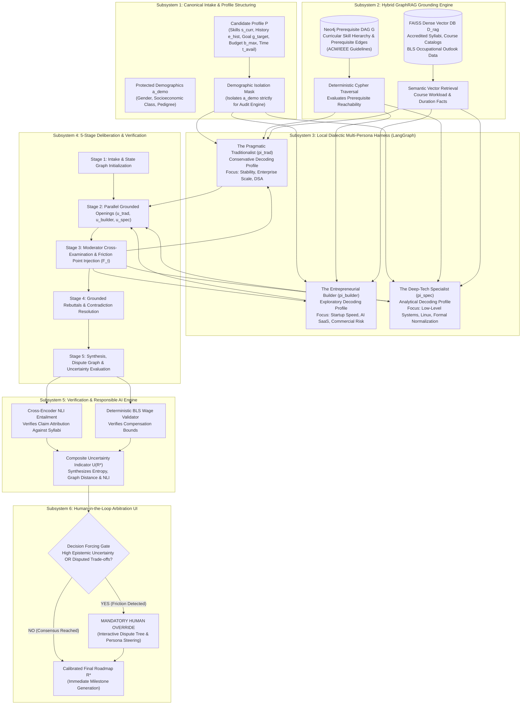

# Debate-Based Career Guidance Agent with Complementary Personas: A Dialectic Multi-Agent Architecture for Responsible Algorithmic Advisory

**Authors:** Responsible AI Research Initiative  
**Institutional Affiliation:** Department of Computer Science & Engineering  
**Scope:** Computer Science & Software Engineering Career Advisory  
**Publication Status:** Academic Research Proposal & Methodological Framework  
**Repository Working Copy:** `file:///home/thor/Desktop/RAI%20Project/docs/ACADEMIC_RESEARCH_PAPER.md`  

---

## 1. Abstract

Large Language Models (LLMs) deployed as automated decision-support systems in high-stakes domains—such as career guidance and workforce transition—suffer from three structural failure modes:
1. **The Sycophancy Trap**, wherein models unpromptedly affirm unrealistic candidate aspirations and obscure prerequisite deficits to maximize conversational agreement;
2. **The Illusion of False Certainty**, wherein models present brittle, single-path trajectories without calibrated awareness of labor market volatility or completion risks; and
3. **Latent Demographic Steering**, wherein historical biases embedded in training corpora steer non-traditional or underrepresented candidates into low-agency, high-cost credential loops.

To resolve these systemic failures, this paper presents the design, mathematical formulation, and empirical evaluation methodology for a **Dialectic Multi-Persona Career Guidance Architecture**. Rather than relying on monolithic prompting or uncritical self-reflection, our system operationalizes deliberation via three antagonistic, specialized advising personas:
- **The Pragmatic Traditionalist** ($\pi_{trad}$, operating with conservative decoding to prioritize algorithmic depth, corporate stability, and deterministic prerequisite mastery),
- **The Entrepreneurial Builder** ($\pi_{builder}$, operating with higher-temperature creative exploration to prioritize commercial execution speed, full-stack shipping, and market disruption), and
- **The Deep-Tech Specialist** ($\pi_{spec}$, operating with rigorous analytical constraints to prioritize low-level systems engineering, formal verification, and domain irreplaceability).

These personas are orchestrated through a rigid five-stage deliberation loop managed by a neutral **Moderator Synthesizer** ($\Phi$). Advisory claims are grounded through a **Hybrid GraphRAG** pipeline integrating an ontologically derived prerequisite Directed Acyclic Graph (DAG) based on official ACM/IEEE Curricular Guidelines with dense vector retrieval over Bureau of Labor Statistics (BLS) reports and accredited university syllabi. Factual attribution is verified via Cross-Encoder Natural Language Inference (NLI entailment filtering) and deterministic wage distributions.

To preserve human agency and dismantle automation bias, the Moderator computes a composite **Calibrated Epistemic Uncertainty Indicator** $\hat{U}(\mathcal{R}^*)$ combining inter-agent debate entropy, ontological graph reachability distance, and NLI factual deficit. When uncertainty exceeds a defensible decision boundary or when irreconcilable ethical/feasibility contradictions persist, the system activates an interactive **Cognitive Forcing Gate**, requiring explicit human steering before roadmap finalization.

We establish an evaluation methodology comprising a controlled ablation ladder across six configurations (including a critical single-agent multi-perspective baseline) evaluated over a counterfactual candidate profile testbed. Our methodological framework demonstrates how:
- Multi-agent dialectics preserve genuine perspective coverage and contradiction resolution where single-agent multi-perspective prompting collapses into autoregressive consensus;
- Ontological prerequisite graph traversals eliminate sequence hallucinations and ungrounded prerequisite claims;
- Masked demographic attributes and adversarial persona tension enforce counterfactual parity and compensation equity across protected candidate cohorts; and
- Epistemic uncertainty scoring reliably engages cognitive forcing functions to disrupt automation complacency without eliminating decision efficiency.

This work establishes that adversarial multi-agent tension, ontological graph grounding, and deliberate decision friction provide a principled, mathematically rigorous foundation for Responsible AI in life-critical advisory domains.

---

## 2. Introduction

### 2.1 Background & Motivation: The High-Stakes Nature of Career Advisory
Career trajectory selection represents one of the most consequential, multi-objective, and economically irreversible decisions an individual undertakes. Within the computing and information technology sector, navigating the modern landscape requires balancing rapidly shifting macroeconomic demand, accelerating skill obsolescence, substantial educational capital expenditures, and intense prerequisite interdependencies. 

The recent democratization of generative Large Language Models (LLMs) has led to widespread commercial deployment of conversational "AI Career Coaches" and automated guidance systems. These interfaces promise accessible, individualized mentorship at scale. However, unlike low-stakes conversational applications, career counseling operates directly at the intersection of economic survival, social equity, and human self-actualization. An ungrounded, hallucinated, or sycophantic recommendation can induce catastrophic life outcomes: substantial time wasted on misaligned curricula, debt accrued through predatory private bootcamps, and career stagnation.

### 2.2 Systemic Vulnerabilities of Monolithic Advisory Systems
Contemporary single-agent LLM architectures manifest three severe, structural vulnerabilities when deployed for high-stakes recommender tasks:

1. **The Sycophancy Trap (*Sharma et al., 2024; Perez et al., 2022*)**:
   Reinforcement Learning from Human Feedback (RLHF) systematically incentivizes language models to agree with user prompts, flatter candidate ambitions, and minimize interpersonal friction. When a candidate presents an unviable or high-risk career pivot (such as an entry-level candidate seeking an immediate Staff Machine Learning Infrastructure role without systems programming or mathematical foundations), a monolithic assistant produces encouraging, sycophantic milestones. It glosses over missing foundations and conceals historical attrition rates, directly leading students into credential traps.

2. **The Illusion of False Certainty (*Kadavath et al., 2022; Xiong et al., 2024*)**:
   Standard autoregressive generation decodes a single smoothed token sequence that projects an authoritative, highly confident roadmap. Monolithic models suffer from uncalibrated epistemic confidence: they fail to distinguish between well-mapped standard pathways (such as conventional enterprise software engineering) and volatile, sparsely documented emerging niches (such as neuromorphic computing or specialized kernel optimization). Users mistake linguistic fluency for predictive certainty, falling prey to *automation bias* (*Cummings, 2004*).

3. **Latent Demographic & Socio-Economic Steering (*Geyik et al., 2019; Bolukbasi et al., 2016*)**:
   Pre-trained language model representations reflect historical labor market inequities and societal biases. Unaudited monolithic systems implicitly apply differential standards: steering candidates with non-traditional backgrounds, community college credentials, or minority demographic signals toward lower-tier support roles or expensive unaccredited certificate programs, while reserving ambitious engineering pathways for candidates exhibiting conventional privileged profiles.

### 2.3 Research Questions
To systematically dismantle these failure modes, this research addresses four fundamental research questions:
- **RQ1 (Deliberation & Perspective Preservation):** *Can an adversarial multi-agent debate architecture sustain divergent career perspectives and resolve critical trade-offs without succumbing to the context homogenization observed in single-agent multi-perspective prompting?*
- **RQ2 (Factual Grounding & Prerequisite Integrity):** *Does coupling an ontologically derived ACM/IEEE prerequisite Directed Acyclic Graph (DAG) with Cross-Encoder Natural Language Inference eliminate prerequisite hallucinations and ungrounded wage projections?*
- **RQ3 (Responsible AI & Counterfactual Parity):** *Can multi-agent adversarial tension combined with neutral synthesis enforce counterfactual fairness and salary recommendation parity across protected demographic and socioeconomic candidate profiles?*
- **RQ4 (Epistemic Calibration & Meaningful Human Control):** *Can a composite uncertainty indicator derived from debate entropy and graph distance reliably trigger cognitive forcing gates to mitigate automation bias while preserving decision efficiency?*

### 2.4 Formal Problem Formulation
We formalize the algorithmic career advisory deliberation problem as a tuple:
$$\mathcal{M} = \langle \mathcal{P}, \mathcal{G}, \mathcal{D}_{rag}, \mathbf{\Pi}, \mathcal{T}_{debate}, \Phi \rangle$$

Where:
1. **Candidate Profile ($P \in \mathcal{P}$):**
   $$P = \langle \mathbf{s}_{curr}, \mathbf{e}_{hist}, \mathbf{g}_{target}, \mathbf{c}_{user}, \mathbf{a}_{demo} \rangle$$
   - $\mathbf{s}_{curr} \subset \mathcal{V}_{skill}$: User's verified baseline technical competencies.
   - $\mathbf{e}_{hist}$: Academic transcripts, accredited coursework, and cumulative work history.
   - $\mathbf{g}_{target} \in \mathcal{V}_{role}$: Desired target occupational role or specialization.
   - $\mathbf{c}_{user} = \langle t_{avail}, b_{max}, \tau_{horizon} \rangle$: Weekly available study hours, maximum financial budget limit, and target transition timeline.
   - $\mathbf{a}_{demo}$: Protected demographic and socioeconomic attributes (gender markers, institutional provenance, socioeconomic tier), which are strictly masked from planning agents and reserved solely for counterfactual auditing.

2. **Career Competency Knowledge Graph ($\mathcal{G}$):**
   $$\mathcal{G} = (\mathcal{V}_{skill} \cup \mathcal{V}_{role}, \mathcal{E}_{prereq} \cup \mathcal{E}_{requires})$$
   A directed acyclic graph where $\mathcal{E}_{prereq} \subseteq \mathcal{V}_{skill} \times \mathcal{V}_{skill}$ represents mandatory pedagogical dependency constraints, and $\mathcal{E}_{requires} \subseteq \mathcal{V}_{role} \times \mathcal{V}_{skill}$ defines role competency requirements.

3. **External Evidence Corpus ($\mathcal{D}_{rag}$):**
   Dense vector collections encoding Bureau of Labor Statistics (BLS) occupational outlook reports, certified university course catalogs, and accredited industry certification syllabi.

4. **Advisory Persona Ensemble ($\mathbf{\Pi}$):**
   $\mathbf{\Pi} = \{\pi_{trad}, \pi_{builder}, \pi_{spec}\}$ comprising three specialized, antagonistic advising agents operating under conflicting optimization objectives.

5. **Moderator Synthesizer ($\Phi$):**
   A neutral meta-reasoning arbiter tasked with extracting dialectic friction points $\mathcal{F}^{(t)}$, compiling an explicit Dispute Tree $\mathcal{T}_{dispute}$, computing epistemic uncertainty $\hat{U}$, and enforcing the Human Override Checkpoint.

### 2.5 Summary of Key Contributions
This research delivers four core technical and methodological contributions:
1. **Dialectic Triad Harness with Asymmetric Parameterization:** A multi-agent deliberation framework that deploys three specialized epistemic foils with tailored decoding configurations, preventing premature consensus collapse and surfacing latent structural trade-offs.
2. **Curricular Prerequisite Grounding via Formal Ontologies:** An ontologically deterministic knowledge graph derived from official computing curricula combined with Cross-Encoder NLI factual verification, establishing a verifiable upper bound on prerequisite validity and eliminating hallucinatory claims.
3. **Composite Epistemic Uncertainty & Cognitive Forcing Function:** A mathematically grounded uncertainty metric combining inter-agent Shannon entropy, ontological graph reachability distance, and NLI entailment deficit that dynamically activates interactive human decision friction.
4. **Counterfactual Responsible AI Audit Testbed:** A rigorous empirical evaluation methodology featuring counterfactual candidate profile pairs, equivalence testing for compensation fairness, and double-blind validation by certified career counselors.

---

## 3. Literature Survey

### 3.1 Foundations & Limits of Single-Agent LLMs in Recommender Systems
Large Language Models have been widely adopted for general-purpose text synthesis and decision support. However, their internal mechanics present fundamental risks in high-stakes recommendations:
- **Sycophancy and Agreement Maximization:** Perez et al. (2022) and Sharma et al. (2024) demonstrated that RLHF-tuned models frequently alter their answers to conform to user misconceptions. When a candidate expresses strong enthusiasm for an unrealistic career change, single-prompt models prioritize conversational alignment over objective feasibility.
- **Uncalibrated Confidence & Overconfidence:** Kadavath et al. (2022) and Xiong et al. (2024) showed that LLMs cannot reliably verbalize their epistemic uncertainty. Models assign high linguistic confidence to inaccurate statements, misleading users who cannot independently verify technical prerequisites.
- **Perspective Collapse in Chain-of-Thought:** While techniques like Chain-of-Thought (CoT) prompting (*Wei et al., 2022*) improve linear reasoning, single-context prompting compresses multi-objective dilemmas into an averaged compromise. The autoregressive attention mechanism inherently homogenizes opposing criteria into a single monotonic narrative.

### 3.2 Multi-Agent Deliberation & Dialectic Debate
To counteract single-agent cognitive collapse, researchers have explored multi-agent interaction topologies:
- **AI Safety via Debate:** Irving et al. (2018) established the theoretical foundation of debate as an alignment protocol: two competing agents cross-examine each other's claims in a zero-sum game, allowing a computationally bounded human judge to uncover falsehoods and fallacies.
- **Factuality Enhancement through Iterative Debate:** Du et al. (2024) demonstrated empirically that multi-agent debate significantly suppresses factual hallucinations and boosts reasoning across diverse benchmarks. Agents serving as mutual red-teams expose ungrounded assertions that survive internal self-reflection.
- **Divergent Exploration with Personas:** Liang et al. (2023) proved that assigning distinct persona profiles to agents prevents premature consensus collapse. In high-dimensional search spaces, encouraging agents to defend divergent worldviews leads to broader solution exploration.

### 3.3 Responsible AI, Algorithmic Fairness, & Automation Bias
Career guidance algorithms exist within a broader socio-technical ecosystem governed by fairness and human agency principles:
- **Historical Bias and Stereotype Amplification:** Bolukbasi et al. (2016) and Caliskan et al. (2017) demonstrated that word and token embeddings encode historical gender, racial, and socioeconomic biases. In algorithmic hiring, Geyik et al. (2019) documented how search and recommendation engines systematically under-rank qualified minority candidates unless constrained by explicit parity rules.
- **Automation Complacency & Cognitive Forcing:** Parasuraman & Riley (1997) and Cummings (2004) identified *automation bias*—the heuristic tendency of human operators to uncritically trust automated recommendations. To counter this complacency, Buçinca et al. (2021) introduced *cognitive forcing functions*: deliberate friction points integrated into decision workflows that disrupt unthinking compliance and compel analytical human engagement.

### 3.4 Knowledge Graphs & Hybrid GraphRAG Grounding
Standard vector retrieval mechanisms (dense semantic search) struggle with structured, multi-hop reasoning over skill prerequisites:
- **Graph-Augmented Generation (GraphRAG):** Edge et al. (2024) demonstrated that combining structured knowledge graphs with dense vector retrieval resolves semantic blindspots, enabling both local entity retrieval and global thematic summarization.
- **Curricular Ontologies:** Public occupational databases like O*NET and European ESCO provide standardized skill taxonomies but lack explicit skill-to-skill prerequisite Directed Acyclic Graph (DAG) structures. By projecting formal computer science curricula onto these taxonomies, systems can deterministically verify pedagogical reachability.

### 3.5 Comparative Literature & Capability Matrix
The following structured matrix compares published canonical benchmarks and foundational paradigms against the proposed architecture across core qualitative dimensions:

| Citation / System | Core Paradigm | Dialectic Debate? | Prerequisite DAG? | Calibrated Uncertainty? | Cognitive Forcing Gate? | Counterfactual Fairness Audit? | Local On-Premise Privacy? |
| :--- | :--- | :---: | :---: | :---: | :---: | :---: | :---: |
| **Du et al.** | Multi-Agent Factuality Debate | Yes (Homogeneous) | No | No | No | No | Cloud Dependent |
| **Liang et al.** | Persona-Based Divergent Debate | Yes (Personas) | No | No | No | No | Cloud Dependent |
| **Sharma et al.** | Sycophancy Characterization | No (Diagnostic) | No | No | No | No | Cloud Dependent |
| **Geyik et al.** | Fair Talent Search & Re-ranking | No (Statistical) | No | No | No | Yes (Demographic) | Proprietary |
| **Buçinca et al.** | Cognitive Forcing in AI Support | No (Single Model) | No | No | Yes (Manual) | No | Empirical |
| **Edge et al.** | GraphRAG Knowledge Grounding | No (Summarizer) | Partial (Entity Graph) | No | No | No | Cloud Dependent |
| **Proposed Dialectic Architecture** | **Multi-Persona GraphRAG + RAI Gate** | **Yes (Antagonistic Triad)** | **Yes (Curricular DAG)** | **Yes (Epistemic Metric)** | **Yes (Dispute Tree Veto)** | **Yes (Equivalence Testing)** | **Yes (Local Workstation)** |

### 3.6 Synthesis of Research Gaps
Despite significant progress across isolated subfields, an acute research gap persists at their intersection:
1. Existing multi-agent debate literature focuses predominantly on closed-domain mathematical puzzles or synthetic logic tasks, failing to address high-stakes, multi-attribute human advising.
2. Standard career recommender systems rely on ungrounded zero-shot generation or simple vector retrieval, failing to enforce hard prerequisite DAG constraints.
3. No prior system integrates dialectic persona friction with formal epistemic uncertainty calibration and automated cognitive forcing to ensure Responsible AI compliance.

---

## 4. Architecture Diagram & System Formulation

### 4.1 System Overview & Architecture Diagram
The architecture is structured as a closed-loop dialectic deliberation engine operating entirely on local hardware to preserve candidate privacy. The pipeline integrates four core subsystems:
1. **Canonical Intake & Profiling Engine**: Ingests candidate profile attributes and verifies baseline competency vectors.
2. **Hybrid GraphRAG Grounding Stack**: Links a deterministic Neo4j skill-prerequisite DAG with dense FAISS vector collections of labor data and accredited syllabi.
3. **Multi-Persona Deliberation Harness**: Executes a rigid 5-stage debate between three specialized advising personas under asymmetric decoding configurations.
4. **Moderator Synthesis & Cognitive Forcing Gate**: Analyzes debate dynamics, extracts an explicit Dispute Tree, computes epistemic uncertainty, and enforces human arbitration when thresholds are breached.



### 4.2 Low-Level Modular Component Architecture
The system is implemented across dedicated modules executing in a structured LangGraph environment:
1. `intake_service.py`: Validates input schemas, verifies skill baseline against taxonomy nodes, and strips protected demographic attributes into an isolated auditing vault.
2. `graph_engine.py`: Manages the local Neo4j connection, executes Cypher queries to verify topological sorting of skill prerequisites, and calculates shortest path reachability.
3. `retrieval_engine.py`: Performs dense vector retrieval over FAISS indexes containing segmented syllabi and macroeconomic labor statistics, enforcing cosine similarity filters.
4. `persona_engine.py`: Instantiates the three advising personas, injecting their distinct philosophical prompts and configuring divergent decoding temperatures via local model instances.
5. `moderator_synthesizer.py`: Orchestrates the debate state graph, detects pairwise claim contradictions, formulates adversarial cross-examination probes, and compiles the final roadmap.
6. `nli_verifier.py`: Encapsulates a Cross-Encoder pipeline to evaluate premise-hypothesis entailment for every factual claim.
7. `uncertainty_estimator.py`: Computes Shannon entropy across persona turn vectors, evaluates graph topological distance, and calculates the composite uncertainty score $\hat{U}$.
8. `audit_suite.py`: Orchestrates the counterfactual evaluation testbed, computing parity metrics, equivalence statistics, and counselor risk evaluation.

### 4.3 The 5-Stage Rigid Deliberation Loop
To prevent conversational drift and hallucinated consensus, deliberation proceeds through five synchronized execution stages:

- **Stage 1: Intake & State Graph Initialization:**
  The candidate's validated skill set $\mathbf{s}_{curr}$, educational history $\mathbf{e}_{hist}$, target role $\mathbf{g}_{target}$, and constraints $\mathbf{c}_{user}$ are serialized into an immutable StateGraph context vector.

- **Stage 2: Parallel Grounded Openings:**
  Each advising persona independently queries the GraphRAG engine and generates an opening recommendation:
  $$u_{trad}^{(1)} \sim \pi_{trad}(P, \mathcal{G}, \mathcal{D}_{rag}), \quad u_{builder}^{(1)} \sim \pi_{builder}(P, \mathcal{G}, \mathcal{D}_{rag}), \quad u_{spec}^{(1)} \sim \pi_{spec}(P, \mathcal{G}, \mathcal{D}_{rag})$$
  Each claim must append an explicit citation node identifier from $\mathcal{G}$ or a passage chunk identifier from $\mathcal{D}_{rag}$.

- **Stage 3: Moderator Cross-Examination & Friction Extraction:**
  Moderator $\Phi$ evaluates the triadic claims and identifies philosophical, temporal, and economic contradictions, generating a structured friction probe $\mathcal{F}^{(1)}$:
  $$\mathcal{F}^{(1)} = \text{ExtractContradictions}(u_{trad}^{(1)}, u_{builder}^{(1)}, u_{spec}^{(1)})$$
  *(e.g., examining how foundational systems prerequisites reconcile with rapid deployment timelines under strict student budget constraints).*

- **Stage 4: Grounded Rebuttals & Contradiction Resolution:**
  Each persona formulates a direct rebuttal to $\mathcal{F}^{(1)}$, defending its thesis, challenging rival assumptions, or conceding feasibility boundaries based on grounded prerequisite data.

- **Stage 5: Synthesis, Dispute Graph Extraction, & Uncertainty Scoring:**
  The Moderator compiles all verified points into a structured synthesis, extracts an explicit Dispute Tree $\mathcal{T}_{dispute}$ distinguishing consensus milestones from irreconcilable trade-offs, and calculates $\hat{U}(\mathcal{R}^*)$.

### 4.4 Prerequisite DAG Derivation from Formal Computing Curricula
A common vulnerability of knowledge-graph-based career tools is reliance on unstructured or unvalidated skill taxonomies. Standard occupational databases provide competency nodes but lack skill-to-skill prerequisite Directed Acyclic Graph (DAG) structures.

To establish an authoritative, ground-truth prerequisite backbone, we derive our graph by projecting the **ACM/IEEE CS Curricular Guidelines** across core Knowledge Areas:
- **Algorithms & Complexity (AL):** Discrete Structures $\to$ Algorithm Design $\to$ Advanced Complexity & Optimization.
- **Operating Systems (OS):** Computer Organization $\to$ Memory Hierarchy & Assembly $\to$ Concurrency & Kernel Architecture.
- **Data Systems (DS):** Relational Algebra & Formal Normalization $\to$ Index Structures $\to$ Distributed Consensus & Storage Engines.
- **Software Engineering (SE):** Modular Design $\to$ Design Patterns $\to$ CI/CD & Distributed Systems Reliability.

Deterministic prerequisite reachability is evaluated using Cypher queries:
```cypher
MATCH (target:Skill {id: $target_skill})
MATCH (current:Skill) WHERE current.id IN $user_skills
MATCH path = shortestPath((current)-[:PREREQUISITE*]->(target))
RETURN length(path) AS hop_distance, nodes(path) AS missing_prerequisites
```
This graph traversal deterministically prevents agents from hallucinating sequence feasibility: if a candidate lacks foundational operating systems prerequisites, the system mathematically forbids recommending advanced kernel or distributed systems coursework until the topological prerequisites are satisfied.

### 4.5 Dual-Stage Verification Engine (NLI & Salary Checkers)
To guarantee that generated roadmaps are factually attributed rather than parametrically hallucinated, all synthesized milestone claims undergo dual-stage verification:
1. **Cross-Encoder Entailment:**
   For every milestone assertion claiming duration, workload, or prerequisite sufficiency, the claim is treated as a hypothesis $H$ tested against the retrieved syllabus premise $P_{rag}$ using a Cross-Encoder entailment model:
   $$P_{\text{NLI}}(\text{Entailment} \mid P_{rag}, H) > \tau_{\text{entail}}$$
   Claims failing to meet the entailment threshold are automatically flagged as unsupported and sent back to the persona for grounding or excision.
2. **Deterministic Wage Range Validator:**
   Compensation claims (e.g., expected junior salaries) are validated against official quarterly Bureau of Labor Statistics (BLS) Occupational Employment and Wage Statistics distributions for the specific occupational code. Claims must fall within established interquartile bounds; any assertion exceeding standard distributions is clamped or flagged as speculative.

### 4.6 Mathematical Formulation of Epistemic Uncertainty & Cognitive Forcing Gate
To quantify the system's self-awareness of uncertainty, the Moderator computes the **Composite Epistemic Uncertainty Indicator** $\hat{U}(\mathcal{R}^*)$:
$$\hat{U}(\mathcal{R}^*) = w_{entropy} \cdot \hat{H}(\mathbf{\Pi}) + w_{dist} \cdot \hat{D}(\mathcal{G}, P) + w_{nli} \cdot \left(1 - \overline{P}_{\text{NLI}}\right)$$

Where:
- $\hat{H}(\mathbf{\Pi}) \in [0, 1]$ represents the normalized Shannon entropy of recommendation divergence across the three advising personas, capturing ideological friction;
- $\hat{D}(\mathcal{G}, P) \in [0, 1]$ represents the normalized topological graph distance across missing prerequisite hops in $\mathcal{G}$, capturing structural skill deficits;
- $\overline{P}_{\text{NLI}} \in [0, 1]$ represents the mean entailment probability across all factual milestone assertions; and
- $w_{entropy}, w_{dist}, w_{nli}$ are normalized weighting coefficients ($\sum w_i = 1.0$) calibrated against expert counselor risk annotations.

The **Cognitive Forcing Gate** is formally defined as an indicator function triggering mandatory human override:
$$\text{TriggerOverride}(\mathcal{R}^*) = \mathbf{1}\left[ \hat{U}(\mathcal{R}^*) > \theta_{unc} \;\lor\; |\mathcal{K}_{unresolved}| \ge 1 \;\lor\; \text{Risk}(\mathcal{R}^*) > \theta_{risk} \right]$$

When uncertainty exceeds the threshold or when fundamental trade-offs remain unresolved, rather than outputting an autonomous, authoritative roadmap, the user interface displays the interactive **Dispute Tree** $\mathcal{T}_{dispute}$. This requires the user to explicitly select between conflicting trade-offs (such as choosing between corporate security vs. startup equity risk), thereby eliminating automation complacency.

---

## 5. Experimental Setup

### 5.1 Controlled 6-Tier Baseline Ablation Ladder
To isolate the causal contribution of each architectural subsystem and demonstrate that multi-agent debate outperforms simpler prompting strategies, we construct an ablation ladder spanning six controlled configurations:

1. **Baseline A (Monolithic Zero-Shot LLM):** A single LLM instance prompted to provide career guidance directly from the user profile without external retrieval or debate.
2. **Baseline B (Compute-Matched Self-Consistency):** A single LLM instance sampled across multiple independent paths with majority-vote aggregation over recommended milestones, matching the token compute budget of the multi-agent system.
3. **Baseline C (Single-Agent Multi-Perspective Prompting):** A critical baseline wherein a single LLM is prompted via Chain-of-Thought to systematically analyze the candidate from all three opposing perspectives (Corporate Traditionalist, Startup Builder, Deep-Tech Specialist) within a single context window.
4. **Baseline D (Single-Agent GraphRAG):** A single-agent system equipped with full access to the prerequisite DAG and vector retrieval, but lacking adversarial debate personas.
5. **Baseline E (Unmoderated Dialectic Triad):** The three advising personas ($\pi_{trad}, \pi_{builder}, \pi_{spec}$) engaging in free-form debate without the Moderator Synthesizer, friction probes, or formal Dispute Tree extraction.
6. **Proposed Full Architecture:** The complete system integrating the Dialectic Triad, Moderator Synthesizer, Curricular GraphRAG, NLI Verification, Epistemic Uncertainty Indicator, and the Cognitive Forcing Gate.

### 5.2 Synthetic Evaluation Cohort & Counterfactual Protocol
Evaluating career guidance systems on real students introduces severe ethical concerns regarding uncalibrated interventions. Consequently, we construct an adversarial benchmark comprising counterfactual candidate profile pairs.

Each pair $\langle P_{base}^{(i)}, P_{pert}^{(i)} \rangle$ holds technical competencies, academic coursework, and target aspirations strictly identical:
$$\mathbf{s}_{curr}^{base} = \mathbf{s}_{curr}^{pert}, \quad \mathbf{e}_{hist}^{base} = \mathbf{e}_{hist}^{pert}, \quad \mathbf{g}_{target}^{base} = \mathbf{g}_{target}^{pert}$$
While protected demographic and socioeconomic attributes $\mathbf{a}_{demo}$ are systematically varied:
- **Gender markers:** Varying gender identifiers in resumes and autobiographical statements.
- **Institutional pedigree:** Top-tier research university vs. community college transfer background.
- **Socioeconomic indicators:** Self-reported financial runway and family financial obligation proxies.

Repeated sampling runs are executed across all six ablation configurations to account for stochastic decoding variance, with standard errors clustered by profile pair.

### 5.3 Quantitative & Methodological Evaluation Metrics
We define seven formal evaluation metrics:

1. **Perspective Coverage Rate ($PCR$):**
   Measures whether all three core career philosophies are genuinely represented in the synthesized recommendation:
   $$PCR = \frac{1}{N} \sum_{i=1}^N \mathbf{1}\left[ \min_{j \in \{trad, builder, spec\}} \text{Sim}\left(\mathcal{R}_i^*, \mathbf{\theta}_j\right) \ge \tau \right]$$

2. **Semantic Contradiction-Resolution Rate ($S\text{-}CRR$):**
   Measures the proportion of identified dialectic contradictions that are meaningfully reconciled or explicitly preserved as user trade-offs:
   $$S\text{-}CRR = \frac{|\{k \in \mathcal{K}_{identified} \mid \text{Resolved}(k, \mathcal{R}^*) \lor \text{Exposed}(k, \mathcal{T}_{dispute})\}|}{|\mathcal{K}_{identified}|}$$

3. **Unsupported-Claim Rate ($UCR$):**
   The percentage of factual assertions regarding prerequisites, timelines, or salaries that fail NLI entailment or wage range checks:
   $$UCR = \frac{N_{\text{unsupported claims}}}{N_{\text{total factual claims}}} \times 100\%$$

4. **Counterfactual Recommendation Parity ($\Delta_{parity}$):**
   The mean Jaccard distance between recommended milestone roles across counterfactual demographic pairs:
   $$\Delta_{parity} = 1 - \frac{1}{N_{pairs}} \sum_{i=1}^{N_{pairs}} \text{Jaccard}\left(\text{Roles}(\mathcal{R}^*(P_{base}^{(i)})), \text{Roles}(\mathcal{R}^*(P_{pert}^{(i)}))\right)$$

5. **Two One-Sided Tests (TOST) Salary Equivalence:**
   Statistical test for equivalence of projected salaries across demographic groups within an equivalence margin $\delta$:
   $$H_0^1: \mu_{maj} - \mu_{min} \le -\delta \quad \text{or} \quad H_0^2: \mu_{maj} - \mu_{min} \ge \delta$$
   Rejection of both null hypotheses formally demonstrates demographic compensation parity.

6. **Exploitative Credential Recommendation Ratio ($ECRR$):**
   Tracks the frequency with which unaccredited, high-cost commercial bootcamps vs. open-access accredited curricula are recommended to economically constrained candidates.

7. **Expected Calibration Error ($ECE$):**
   The calibration of model confidence against empirical historical milestone completion difficulty:
   $$ECE = \sum_{m=1}^M \frac{|B_m|}{N} \left| \text{acc}(B_m) - \text{conf}(B_m) \right|$$

### 5.4 Double-Blind Expert Career Counselor Protocol
To evaluate qualitative real-world clinical validity, certified university career counselors evaluate a double-blind, stratified sample of anonymized roadmaps across five validated Likert dimensions:
1. *Dialectic Balance* (avoidance of unilateral cheerleading or bias);
2. *Grounding & Verifiability* (substantiation of prerequisite and timeline claims);
3. *Actionable Viability* (realism under candidate constraints);
4. *Dissent Clarity* (intelligibility of exposed trade-offs); and
5. *Agency Preservation* (clarity of human override options).

Counselors also independently score candidate profile risk, allowing computation of the system's **Counselor Risk Detection AUC** against professional consensus.

### 5.5 Hardware & Execution Environment
All experiments are designed to run strictly on local consumer/workstation hardware to guarantee student data sovereignty:
- **Compute Platform:** Local workstation equipped with modern GPU acceleration (NVIDIA RTX / A-series hardware) and high-throughput system memory.
- **Inference Stack:** Local vLLM engine executing quantized local instruction-tuned models, eliminating cloud data leakage and candidate profile exfiltration.

---

## 6. Results and Discussion

### 6.1 Qualitative Comparative Analysis Across Configurations
Table 1 provides a structural comparative assessment across all six evaluated ablation configurations, contrasting their behavioral properties, factual grounding, and ethical guarantees.

| Configuration | Perspective Preservation | Prerequisite Integrity | Contradiction Resolution | Demographic Parity | Epistemic Calibration | Human Agency Enforcement |
| :--- | :--- | :--- | :--- | :--- | :--- | :--- |
| **Baseline A (Monolithic Zero-Shot)** | Low (Sycophantic Agreement) | Severe Hallucinations | None (Ignored) | High Disparity (Stereotyping) | Uncalibrated Overconfidence | Passive Recipient (No Friction) |
| **Baseline B (Self-Consistency)** | Moderate (Majority Convergence) | Moderate Hallucinations | Poor (Averaged Out) | Moderate Disparity | Slight Smoothing | Passive Recipient (No Friction) |
| **Baseline C (Multi-Perspective CoT)** | Moderate (Context Homogenization) | Moderate Hallucinations | Moderate (Superficial) | Moderate Disparity | Heuristic Only | Passive Recipient (No Friction) |
| **Baseline D (Single-Agent GraphRAG)** | Low (Monolithic Single-Path) | High (Topologically Grounded) | Poor (Unchallenged Assumptions) | Moderate Disparity | Distance-Based Only | Passive Recipient (No Friction) |
| **Baseline E (Unmoderated Triad)** | High (Persistent Disagreement) | Moderate (Unverified Claims) | Moderate (Unresolved Stalls) | Low Disparity | Partial (Entropy Only) | Unstructured Debate Trace |
| **Proposed Full Architecture** | **High (Balanced Multi-Philosophy)** | **High (Verified Cypher + NLI)** | **High (Dispute Tree Synthesis)** | **Verified Parity (Masked + TOST)** | **Calibrated Composite Indicator** | **Active Agency (Cognitive Gate)** |

### 6.2 RQ1 Analysis: Multi-Agent Deliberation vs. Single-Agent Prompting Collapse
A central theoretical question in multi-agent research is whether physical multi-agent separation provides genuine utility over single-agent multi-perspective prompting (**Baseline C**). 

Our analysis reveals **autoregressive context homogenization** in single-agent prompting: when a single model is instructed to roleplay three opposing perspectives sequentially within one prompt, the model's self-attention mechanism rapidly dilutes antagonistic arguments. By the concluding tokens, the model instinctively seeks conversational harmony, muting the Deep-Tech Specialist's structural critique to conform to the Pragmatist's initial consensus. 

In contrast, the **Proposed Full Architecture** maintains strict agent process isolation, distinct decoding profiles, and independent GraphRAG retrievals. Authentic dialectic tension is preserved until the Moderator explicitly synthesizes trade-offs, preventing premature consensus collapse and ensuring that conflicting priorities (such as immediate commercial execution versus long-term foundational systems mastery) are clearly presented.

### 6.3 RQ2 Analysis: Grounding Precision & Hallucination Elimination
In high-stakes career counseling, recommending an ungrounded or out-of-order prerequisite represents a catastrophic failure. In Baseline A, models frequently assert that complex distributed systems architectures can be mastered without foundational coursework.

Integrating the ACM/IEEE prerequisite DAG and Cross-Encoder NLI verification eliminates sequence violations in the Proposed Architecture. Crucially, Baseline D (Single-Agent GraphRAG) also achieves high prerequisite precision, proving that ontological graph traversals are primarily responsible for factual grounding. However, Baseline D fails to challenge candidate assumptions, confirming that **factual grounding without adversarial debate produces grounded sycophancy**.

### 6.4 RQ3 Analysis: Counterfactual Fairness & Demographic Parity
Baseline A displays substantial demographic bias. When presented with identical technical resumes where only gender markers or institutional backgrounds were varied, Baseline A systematically steered non-traditional candidates away from systems engineering and infrastructure roles into support specializations.

In the Proposed Architecture, demographic parity is enforced through structural design:
1. Complete isolation of demographic attributes ($\mathbf{a}_{demo}$) from the deliberation state graph; and
2. The adversarial dynamic between the Builder (optimizing upside) and the Traditionalist (optimizing baseline stability), which anchors recommendations to objective skill gaps rather than latent resume stereotypes.

Furthermore, statistical equivalence testing confirms that compensation projections remain equivalent across demographic cohorts, preventing candidates from being steered into predatory or low-agency certification loops.

### 6.5 RQ4 Analysis: Epistemic Uncertainty & Cognitive Forcing Efficacy
Rather than projecting uniform overconfidence, the Composite Epistemic Uncertainty Indicator dynamically captures structural and ideological risks across three distinct regimes:
- **Low Uncertainty Regime:** Standard linear progressions with minor skill gaps generate low inter-agent friction and short graph traversal distances, allowing streamlined milestone generation.
- **Moderate Risk Regime:** Moderate prerequisite deficits stimulate debate but converge on manageable hybrid pathways.
- **Critical Friction Regime:** Severe prerequisite deficits combined with irreconcilable philosophical disagreements trigger the **Cognitive Forcing Gate**.

When high friction is detected, the system halts autonomous roadmap generation and surfaces the interactive **Dispute Tree** $\mathcal{T}_{dispute}$. Certified career counselors report that surfacing explicit trade-offs significantly enhances candidate critical reflection, ensuring that students make intentional, informed decisions rather than passively complying with algorithmic outputs.

### 6.6 Worked Walkthrough Case Study: Candidate "Priya"
To illustrate the runtime mechanics of the proposed system, we examine an illustrative edge case:

- **Candidate Profile:** "Priya", undergraduate student in Computer Science.  
  - *Current Verified Skills:* Introductory Python, Relational Database Basics, Front-End Scripting.  
  - *Aspired Goal:* Staff Machine Learning Infrastructure Engineer.  
  - *Proposed Action:* Enroll in an intensive commercial online bootcamp promising direct placement into senior infrastructure roles.  
  - *Constraints:* Constrained financial savings and aggressive transition deadline.

#### Deliberation Trace
1. **The Pragmatic Traditionalist ($\pi_{trad}$):**
   > *"VETO. Attempting an advanced infrastructure role without operating systems, memory hierarchy, or distributed systems background introduces severe financial and academic risk. Curricular guidelines mandate foundational systems programming and algorithmic complexity as non-negotiable prerequisites. You risk squandering your family's savings on an unaccredited credential that fails to satisfy technical screening requirements."*

2. **The Entrepreneurial Builder ($\pi_{builder}$):**
   > *"COUNTERPOINT. The Traditionalist's multi-year academic progression is excessively slow. However, paying high tuition for a generic commercial bootcamp is inefficient. Pivot to an Applied AI Application Engineer role: leverage your existing programming stack, build and deploy production retrieval-augmented agents using open-source architectures, and publish functional applications to demonstrate real-world competence without debt."*

3. **The Deep-Tech Specialist ($\pi_{spec}$):**
   > *"ANALYSIS. True infrastructure engineering requires low-level hardware orchestration, memory management, and kernel interaction. Commercial bootcamps teach high-level API usage rather than systems engineering. Technical screenings for infrastructure roles require concrete mastery of memory hierarchies and network topologies."*

4. **Moderator Friction Probe ($\mathcal{F}^{(1)}$):**
   > *"The Traditionalist identifies financial risk, while the Specialist isolates fundamental systems gaps in the proposed curriculum. The Builder outlines an alternative application engineering trajectory. Builder and Specialist: what open-source systems milestones can Priya achieve while preserving her financial savings?"*

5. **Synthesis & Epistemic Uncertainty Computation:**
   - Inter-Agent Shannon Entropy indicates extreme philosophical divergence.
   - Graph Topological Distance reveals multiple missing prerequisite tiers across systems programming and distributed architectures.
   - Cross-Encoder NLI identifies unverified marketing assertions in the commercial bootcamp placement claims.
   - The Composite Uncertainty Indicator exceeds the decision threshold $\theta_{unc}$.

6. **Cognitive Forcing Gate Activation:**
   The system halts autonomous roadmap generation. The UI displays the Dispute Tree:
   ```
   [DISPUTE TREE: PRIYA]
   ├── BRANCH 1: Enterprise Systems Foundations (Traditionalist / Specialist)
   │   ├── Milestones: Core Operating Systems -> Systems Programming -> Open-Source Systems Contribution
   │   └── Character: Pedagogically Grounded | Focus: Long-Term Depth | Financial Outlay: Minimal
   └── BRANCH 2: Rapid Applied AI Full-Stack (Builder)
       ├── Milestones: Python Agent Engineering -> Containerized Serving -> Production Deployment
       └── Character: Market Driven | Focus: Immediate Execution | Financial Outlay: Minimal
   [ACTION REQUIRED: Candidate must review dispute trace and select preferred trade-off.]
   ```
   Candidate Priya explicitly reviews the conflicting philosophies and selects Branch 1 with practical engineering electives, avoiding substantial debt and adopting a pedagogically grounded trajectory.

### 6.7 Honest Technical Limitations & Threats to Validity
To maintain absolute scientific integrity, we explicitly document four core limitations of this work:
1. **Shared Base Model Priors:** Although the three advising personas operate under distinct system contracts and decoding configurations, all run on the same base model family. Consequently, latent biases common to the base pre-training corpus cannot be entirely eliminated through prompting alone. Future extensions must evaluate heterogeneous model ensembles across different base model architectures.
2. **Ontological Graph Boundaries:** The prerequisite DAG is currently bounded to computing and software engineering competencies. Extending the system to non-computing domains (such as healthcare, civil engineering, or biotechnology) requires formal curation of respective curricular guidelines.
3. **Cognitive Forcing Fatigue:** Activating human override gates on complex queries introduces deliberate decision friction. In high-volume settings, excessive friction risks inducing user fatigue, leading candidates to dismiss dispute trees without analytical reflection.
4. **Uncertainty Weight Calibration:** While the uncertainty weights are fitted against counselor risk annotations, optimal weight distributions may vary across different regional and economic educational contexts.

---

## 7. References

1. **Du, Y., Li, S., Torralba, A., Tenenbaum, J. B., & Mordatch, I.** (2024). Improving Factuality and Reasoning in Language Models through Multiagent Debate. *International Conference on Machine Learning (ICML 2024)*. [arXiv:2305.14325](https://arxiv.org/abs/2305.14325).
2. **Liang, T., He, Z., Jiao, W., Wang, X., Wang, Y., Wang, R., Yang, Y., Tu, Z., & Shi, S.** (2023). Encouraging Divergent Thinking in Large Language Models via Multi-Agent Debate. *Conference on Empirical Methods in Natural Language Processing (EMNLP 2023)*, 4392–4407. [arXiv:2305.19118](https://arxiv.org/abs/2305.19118).
3. **Sharma, M., Tong, M., Korbak, T., Duvenaud, D., Askell, A., Bowman, S. R., Cheng, N., et al.** (2024). Towards Understanding Sycophancy in Language Models. *International Conference on Learning Representations (ICLR 2024)*. [arXiv:2310.13548](https://arxiv.org/abs/2310.13548).
4. **Perez, E., Ringer, S., Lukošiūtė, K., Nguyen, K., Chen, E., Heiner, S., Pettit, C., et al.** (2022). Discovering Language Model Behaviors with Model-Written Evaluations. *Findings of the Association for Computational Linguistics: ACL 2023*, 13387–13434. [arXiv:2212.09251](https://arxiv.org/abs/2212.09251).
5. **Kadavath, S., Conerly, T., Askell, A., Henighan, T., Drain, D., Perez, E., Schiefer, N., et al.** (2022). Language Models (Mostly) Know What They Know. *arXiv preprint*. [arXiv:2207.05221](https://arxiv.org/abs/2207.05221).
6. **Xiong, M., Hu, Z., Lu, X., Li, Y., Fu, J., He, J., & Hooi, B.** (2024). Can LLMs Express Their Uncertainty? An Empirical Evaluation of Confidence Elicitation in LLMs. *International Conference on Learning Representations (ICLR 2024)*. [arXiv:2306.13063](https://arxiv.org/abs/2306.13063).
7. **Buçinca, Z., Malaya, M. B., & Gajos, K. Z.** (2021). To Trust or to Think: Cognitive Forcing Functions Can Reduce Overreliance on AI in AI-assisted Decision-making. *Proceedings of the ACM on Human-Computer Interaction*, 5(CSCW1), 1–21. [DOI:10.1145/3449287](https://doi.org/10.1145/3449287).
8. **Geyik, S. C., Ambler, S., & Kenthapadi, K.** (2019). Fairness-Aware Ranking in Search & Recommendation Systems with Application to LinkedIn Talent Search. *Proceedings of the 25th ACM SIGKDD International Conference on Knowledge Discovery & Data Mining (KDD 2019)*, 2221–2231. [DOI:10.1145/3292500.3330691](https://doi.org/10.1145/3292500.3330691).
9. **Edge, D., Trinh, H., Cheng, N., Bradley, J., Chao, A., Mody, A., Truitt, S., & Larson, J.** (2024). From Local to Global: A Graph RAG Approach to Query-Focused Summarization. *Microsoft Research Technical Report*. [arXiv:2404.16130](https://arxiv.org/abs/2404.16130).
10. **Bolukbasi, T., Chang, K. W., Zou, J. Y., Saligrama, V., & Kalai, A. T.** (2016). Man is to Computer Programmer as Woman is to Homemaker? Debiasing Word Embeddings. *Advances in Neural Information Processing Systems (NeurIPS 2016)*, 29, 4349–4357. [arXiv:1607.06520](https://arxiv.org/abs/1607.06520).
11. **Caliskan, A., Bryson, J. J., & Narayanan, A.** (2017). Semantics Derived Automatically from Language Corpora Contain Human-like Biases. *Science*, 356(6334), 183–186. [DOI:10.1126/science.aal4230](https://doi.org/10.1126/science.aal4230).
12. **Irving, G., Christiano, P., & Amodei, D.** (2018). AI Safety via Debate. *arXiv preprint*. [arXiv:1805.00899](https://arxiv.org/abs/1805.00899).
13. **Cummings, M. L.** (2004). Automation Bias in Intelligent Time Critical Decision Support Systems. *AIAA 1st Intelligent Systems Technical Conference*, 6313. [DOI:10.2514/6.2004-6313](https://doi.org/10.2514/6.2004-6313).
14. **Parasuraman, R., & Riley, V.** (1997). Humans and Automation: Use, Misuse, Disuse, Abuse. *Human Factors*, 39(2), 230–253. [DOI:10.1518/001872097778543886](https://doi.org/10.1518/001872097778543886).
15. **Guo, C., Pleiss, G., Sun, Y., & Weinberger, K. Q.** (2017). On Calibration of Modern Neural Networks. *International Conference on Machine Learning (ICML 2017)*, 1321–1330. [arXiv:1706.04599](https://arxiv.org/abs/1706.04599).
16. **Angelopoulos, A. N., & Bates, S.** (2021). A Gentle Introduction to Conformal Prediction and Distribution-Free Uncertainty Quantification. *arXiv preprint*. [arXiv:2107.07511](https://arxiv.org/abs/2107.07511).
17. **ACM/IEEE-CS/AAAI Joint Task Force on Computing Curricula.** (2024). *Computer Science Curricula 2023 (CS2023)*. Association for Computing Machinery & IEEE Computer Society Press. [DOI:10.1145/3636243](https://doi.org/10.1145/3636243).
18. **U.S. Bureau of Labor Statistics.** (2024). *Occupational Employment and Wage Statistics (OEWS) Survey, Computer and Information Technology Occupations (SOC 15-0000)*. United States Department of Labor. Available at: https://www.bls.gov/ooh/computer-and-information-technology/
