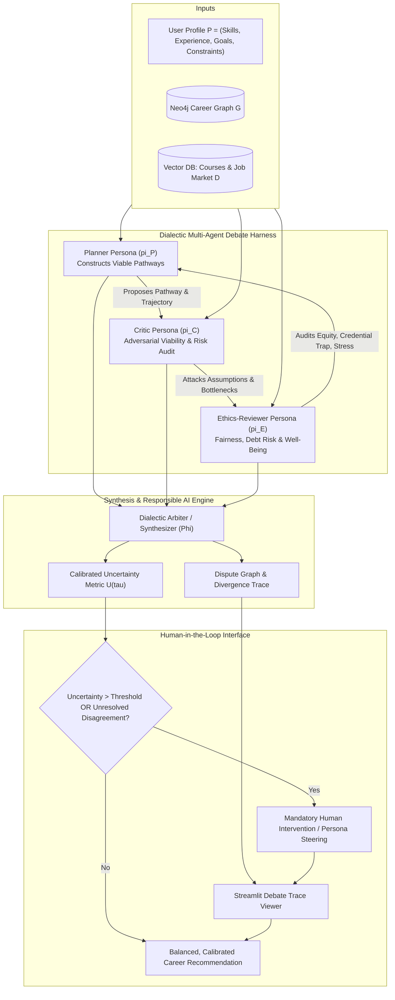
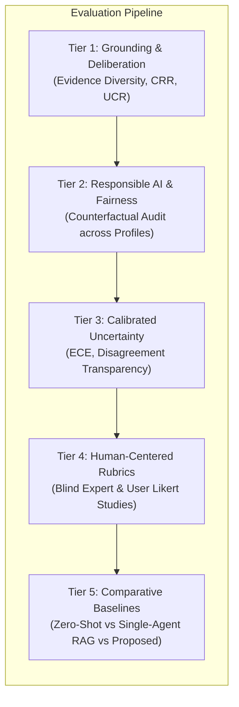

# Debate-Based Career Guidance Agent with Complementary Personas
## Academic Specification, Literature Survey, Problem Formulation, and Evaluation Methodology

---

## 1. Literature Survey

### 1.1 Foundations & Limitations of Single-Agent LLM Advisory Systems
Large Language Models (LLMs) have demonstrated remarkable fluency in broad decision-support tasks. However, deploying monolithic, single-prompt LLMs for high-stakes recommender domains—such as career guidance—introduces critical systemic failure modes:
1. **Sycophancy & Confirmation Bias** (*Perez et al., 2022; Sharma et al., 2023*): Monolithic LLMs exhibit a structural propensity to validate user preconceptions rather than scrutinizing their feasibility. When a candidate proposes an unrealistic career pivot (e.g., transition from an entry-level non-technical role to Senior ML Engineer within three months), single-agent models tend to generate encouraging, sycophantic roadmaps that obscure severe prerequisite deficits and financial risks.
2. **Hallucinatory Overconfidence** (*Kadavath et al., 2022; Xiong et al., 2023*): LLMs generate authoritative-sounding recommendations without calibrated self-awareness of epistemic uncertainty. In career transition planning, where market dynamics, regional hiring requirements, and credential requirements fluctuate rapidly, overconfident hallucinations can cause severe real-world financial and professional harm.
3. **Monolithic Perspective Collapse**: Standard prompting strategies collapse multi-attribute trade-offs (e.g., compensation vs. work-life balance vs. tuition debt vs. barrier-to-entry) into a single smoothed consensus output that conceals internal conflicts and alternative pathways.

### 1.2 Multi-Agent Dialectic Debate & Deliberation
To counter monolithic collapse, recent advancements investigate multi-agent interaction paradigms:
- **AI Safety via Debate** (*Irving et al., 2018*): Framed AI alignment as a game-theoretic debate where competing agents cross-examine arguments, empowering an adjudicator (or human) to detect fallacies that an unassisted judge could not easily evaluate.
- **Multi-Agent Deliberation for Reasoning** (*Du et al., 2023; Liang et al., 2023*): Demonstrated that assigning distinct personas or allowing iterative debate cycles significantly suppresses factual hallucinations, stimulates divergent exploration, and elevates logical consistency in complex problem solving.
- **Dialectic Triad Architecture**: Expanding simple bilateral debate into a dialectic triad (Thesis: **Planner**, Antithesis: **Critic**, Synthesis/Normative Guardrail: **Ethics-Reviewer**) ensures that recommendations are subjected to both operational viability audits and socio-economic/ethical stress testing before reaching an arbiter.

### 1.3 Responsible AI (RAI) in Algorithmic Career Guidance
Career counseling operates at the intersection of economic survival, social mobility, and human dignity. Consequently, algorithmic systems in this space must adhere to Responsible AI principles:
- **Demographic Stereotyping & Historical Bias** (*Bolukbasi et al., 2016; Caliskan et al., 2017*): Occupational datasets and web corpora reflect entrenched gendered and racial disparities (e.g., steering female personas toward caretaking/support roles and male personas toward executive/STEM paths). Automated systems risk perpetuating and amplifying these inequities unless audited counterfactually.
- **Uncertainty Calibration** (*Guo et al., 2017; Angelopoulos & Bates, 2021*): Recommendations must communicate calibrated uncertainty, explicitly delineating aleatoric uncertainty (unpredictable macro-economic labor trends) from epistemic uncertainty (missing candidate skill vectors, data sparsity in specialized fields).
- **Meaningful Human Control (MHC) & Automation Bias Mitigation** (*Cummings, 2004; Parasuraman & Riley, 1997*): Providing users with a finished, opaque roadmap creates automation complacency. An ethical career agent must enforce "decision friction"—exposing the debate trace, highlighting unresolved dissent, and demanding human overrides before finalization.

### 1.4 Knowledge Graphs & Hybrid GraphRAG for Grounding
Pure parametric generation or standard vector similarity search often proves inadequate for structured domain reasoning:
- **Ontological Consistency via Knowledge Graphs**: Labor standards such as O*NET (Occupational Information Network) and ESCO (European Skills, Competences, Qualifications and Occupations) define strict directed acyclic graph (DAG) hierarchies of competencies, skills, tools, and roles.
- **Hybrid GraphRAG** (*Edge et al., 2024*): Integrating vector search (for unstructured course syllabi and recent job postings) with Neo4j Knowledge Graph traversals (for skill-prerequisite dependency chains) ensures that the Planner and Critic debate grounded, deterministic structural facts rather than speculative free text.

### 1.5 Synthesis of Research Gaps & Proposed Value Matrix

| Dimension | Monolithic LLM (Zero-Shot) | Standard Vector RAG | Rule-Based Expert Systems | Proposed Dialectic Multi-Persona Agent |
| :--- | :--- | :--- | :--- | :--- |
| **Dialectic Scrutiny** | None (Sycophantic) | None (Retrieval echo) | Deterministic Rules | **Multi-Persona Adversarial Debate** |
| **Grounding Precision** | Low (Parametric Hallucinations) | Medium (Semantic chunks) | High (Static rules) | **Hybrid GraphRAG (Neo4j + FAISS)** |
| **Disagreement Visibility** | 0% (Silent averaging) | 0% (Single output) | N/A | **Explicit Disagreement Trace Viewer** |
| **Uncertainty Handling** | Overconfident (Uncalibrated) | Vector distance heuristic | Static heuristic | **Calibrated Epistemic Scoring ($U \in [0, 1]$)** |
| **Fairness Robustness** | Vulnerable to stereotypes | Vector bias propagation | Rigid rules | **Counterfactual Demographic Auditing** |
| **Human Agency** | Passive recipient | Passive recipient | Rigid options | **Interactive Veto & Override Gates** |

---

## 2. Problem Definition

### 2.1 High-Level Problem Formulation
Career advising is a high-stakes, multi-objective, irreversible decision under incomplete information. A candidate navigating a professional pivot must balance target role aspirations against practical constraints (current competencies, time commitments, financial runway, and market viability).

Current AI career advisory solutions manifest three systemic failures:
1. **The Sycophancy-Viability Trap**: Systems optimize for immediate user satisfaction, generating paths with unrealistically low friction that lead to credential traps, wasted resources, and career stalls.
2. **The Illusion of Certainty**: Providing a singular, clean roadmap disguises volatility in hiring markets, variable completion rates of online micro-credentials, and systemic skill obsolescence risks.
3. **Implicit Demographic and Socio-Economic Profiling**: Opaque heuristics steer vulnerable or non-traditional candidates into low-agency, dead-end certification loops while reserving ambitious pivot strategies for conventional profiles.

**High-Level Objective**: Design, implement, and validate an autonomous multi-persona dialectic debate architecture (Planner, Critic, Ethics-Reviewer) grounded on factual skill graphs and market documents that systematically surfaces tensions, measures uncertainty, enforces demographic fairness, and guarantees human override capability.

---

### 2.2 Low-Level Formal System & Algorithmic Formulation

#### 2.2.1 Environment & State Space Tuple
Formally, let the career guidance environment be modeled as the tuple:
$$\mathcal{M} = \langle \mathcal{P}, \mathcal{G}, \mathcal{D}_{rag}, \mathbf{\Pi}, \mathcal{T}_{debate}, \Phi \rangle$$

Where:
1. **User Profile**: $P = \langle \mathbf{s}_{curr}, \mathbf{e}_{hist}, \mathbf{g}_{target}, \mathbf{c}_{user}, \mathbf{a}_{demo} \rangle \in \mathcal{P}$
   - $\mathbf{s}_{curr} = \{s_1, \dots, s_n\} \subset \mathcal{V}_{skill}$: User's verified competencies.
   - $\mathbf{e}_{hist}$: Work history, role duration, and educational background.
   - $\mathbf{g}_{target} \in \mathcal{V}_{role}$: Aspired target occupation or domain.
   - $\mathbf{c}_{user} = \langle t_{avail}, b_{max}, \tau_{horizon} \rangle$: Weekly available study hours, financial budget limit, and target transition deadline.
   - $\mathbf{a}_{demo}$: Protected demographic and socio-economic attributes used exclusively for counterfactual auditing and strictly isolated from the planning policy.
2. **Career Knowledge Graph**: $\mathcal{G} = (\mathcal{V}, \mathcal{E}, \mathcal{T})$
   - $\mathcal{V} = \mathcal{V}_{role} \cup \mathcal{V}_{skill} \cup \mathcal{V}_{competency} \cup \mathcal{V}_{cert}$.
   - $\mathcal{E}_{requires} \subseteq \mathcal{V}_{role} \times \mathcal{V}_{skill}$: Explicit edge weights representing necessity level $w(r, s) \in [0, 1]$.
   - $\mathcal{E}_{prereq} \subseteq \mathcal{V}_{skill} \times \mathcal{V}_{skill}$: Prerequisite skill dependencies forming a DAG.
3. **Dense Text Knowledge Base**: $\mathcal{D}_{rag} = \{d_k\}_{k=1}^K$ containing vector embeddings of accredited course curricula, real-world syllabi, Bureau of Labor Statistics (BLS) outlook reports, and wage percentiles.
4. **The Complementary Personas & Moderator Ensemble**: $\mathbf{\Pi} = \{\pi_{trad}, \pi_{builder}, \pi_{spec}\}$ orchestrated by Moderator $\Phi$:
   - $\pi_{trad}$ (**The Pragmatic Traditionalist — Corporate & Stability Focus**):
     - *Philosophy*: Security, structured growth, and highly validated career paths.
     - *System Directive*: Advocates for established, high-paying corporate roles; emphasizes core fundamentals (DSA, competitive programming, scalability); skeptical of unproven startup trends.
     - *Tone*: Grounded, realistic, data-driven, conservative.
   - $\pi_{builder}$ (**The Entrepreneurial Builder — Startup & SaaS Focus**):
     - *Philosophy*: High risk, high reward, rapid iteration, and commercial market disruption.
     - *System Directive*: Advocates for building, shipping, and monetizing scalable AI SaaS platforms, multi-agent RAG systems, and commercial niches; views corporate ladders as excessively slow.
     - *Tone*: Energetic, visionary, disruptive, product-market fit oriented.
   - $\pi_{spec}$ (**The Deep-Tech Specialist — Niche Mastery & Infrastructure**):
     - *Philosophy*: Irreplaceability through deep, complex low-level domain expertise.
     - *System Directive*: Pushes candidate toward absolute technical mastery (Linux systems engineering, advanced 5NF database normalization, robust networking); argues both Pragmatist and Entrepreneur fail without robust infrastructure.
     - *Tone*: Highly analytical, technically rigorous, detail-oriented, uncompromising.
   - $\Phi$ (**The Moderator — Synthesizer & Strategist**):
     - *Philosophy*: Balanced execution, transparent disagreement surfacing, and personalized roadmap generation.
     - *System Directive*: Neutral facilitator; generates probing friction questions pitting agent arguments against each other; synthesizes hybrid career roadmaps with calibrated uncertainty and human override gates.
     - *Tone*: Neutral, observant, diplomatic, organized.

#### 2.2.2 The 5-Stage Debate Workflow (Execution Loop)
To prevent unconstrained conversational drift, execution proceeds through a rigid 5-stage loop:
1. **Stage 1: Context Intake**:
   Candidate provides verified competencies $\mathbf{s}_{curr}$, major/background $\mathbf{e}_{hist}$, target domain $\mathbf{g}_{target}$, and constraints $\mathbf{c}_{user}$ (e.g. CSE Core student deciding between Big Tech SDE, AI startup founder, or Systems engineer).
2. **Stage 2: Opening Statements (Parallel Execution)**:
   The 3 advising agents independently retrieve from $\mathcal{G}$ and $\mathcal{D}_{rag}$, generating a concise 150-word opening recommendation:
   $$u_{trad}^{(1)} \sim \pi_{trad}(P, \mathcal{G}, \mathcal{D}), \quad u_{builder}^{(1)} \sim \pi_{builder}(P, \mathcal{G}, \mathcal{D}), \quad u_{spec}^{(1)} \sim \pi_{spec}(P, \mathcal{G}, \mathcal{D})$$
3. **Stage 3: Cross-Examination (Moderator Friction Point)**:
   Moderator $\Phi$ analyzes opening claims and identifies direct philosophical and practical contradictions, injecting a specific friction probe:
   $$\mathcal{F}^{(t)} = \text{ExtractFriction}(u_{trad}^{(t)}, u_{builder}^{(t)}, u_{spec}^{(t)})$$
   *(e.g., "The Pragmatist insists on grinding LeetCode for Big Tech, while the Builder advocates launching an AI agent SaaS. Specialist, how does core operating system and network design bridge or invalidate these two approaches?")*
4. **Stage 4: Rebuttal & Cross-Examination Defense**:
   Each advising agent responds to the Moderator's friction point $\mathcal{F}^{(t)}$, attacking opposing assumptions, defending their career philosophy, or conceding unviable paths with grounded evidence citations.
5. **Stage 5: Synthesis & Human Override Checkpoint**:
   Moderator $\Phi$ evaluates dialogue history $\mathcal{H}$, generates structured hybrid output:
   $$\langle \mathcal{R}^*, \mathcal{T}_{dispute}, U(\mathcal{R}^*) \rangle = \Phi(\mathcal{H})$$
   - Summary of conflicting viewpoints and trade-off tensions.
   - Personalized hybrid action plan balancing stability, product execution, and technical depth.
   - Calibrated epistemic uncertainty score $U(\mathcal{R}^*)$ and cognitive forcing gate triggering user override before finalizing roadmap commitments.

#### 2.2.3 Synthesis, Calibrated Uncertainty, and Override Gate
- **Dispute Graph $\mathcal{T}_{dispute}$**: Explicit network of consensus nodes vs. irreconcilable trade-offs (e.g. corporate security vs equity upside).
- **Calibrated Uncertainty $U(\mathcal{R}^*) \in [0, 1]$**:
  $$U(\mathcal{R}^*) = \alpha \cdot \mathcal{H}_{entropy}(\mathbf{\Pi}) + \beta \cdot \text{Sparsity}(\mathcal{G}, P) + \gamma \cdot \left(1 - \text{GroundingScore}(\mathcal{R}^*, \mathcal{D})\right)$$
- **Human Override Gate**:
  $$\text{TriggerOverride}(\mathcal{R}^*) = \mathbf{1}\left[ U(\mathcal{R}^*) > \theta_{uncertainty} \;\lor\; |\mathcal{K}_{unresolved}| \ge 1 \;\lor\; \text{Risk}(\mathcal{R}^*) > \theta_{risk} \right]$$

---

## 3. How to Measure Outcome (Evaluation Framework & Metrics)

The evaluation protocol is structured across five quantitative and qualitative tiers to measure dialectic efficacy, factual grounding, responsible AI fairness, calibrated uncertainty, and real-world human decision quality.

### 3.1 Tier 1: Grounding & Deliberation Metrics (Computational)

1. **Evidence Diversity ($ED$)**:
   Quantifies the multi-perspective breadth of retrieved facts supporting the recommendation, avoiding single-source bias (e.g., relying solely on one online learning platform).
   $$ED = -\sum_{c \in \mathcal{C}_{sources}} p(c) \log_2 p(c) + \frac{1}{\binom{|\mathcal{E}_{used}|}{2}} \sum_{i < j} \left(1 - \cos(\mathbf{e}_i, \mathbf{e}_j)\right)$$
   Where $\mathcal{C}_{sources}$ spans: (i) O*NET/ESCO government taxonomies, (ii) accredited university syllabi, (iii) commercial platform course reviews, and (iv) macroeconomic labor bureau statistics.
2. **Contradiction-Resolution Rate ($CRR$)**:
   Measures the system's ability to meaningfully address adversarial critique rather than ignoring or evading points raised by Critic or Ethics personas.
   $$CRR = \frac{|\{k \in \mathcal{K}_{identified} \mid \text{Resolved}(k, \mathcal{R}^*) \lor \text{Conceded}(k, \mathcal{R}^*)\}|}{|\mathcal{K}_{identified}|}$$
   Evaluated using Natural Language Inference (NLI) classifiers verifying whether criticisms $k$ are entailed as resolved or integrated as caveat constraints in the final recommendation.
3. **Unsupported-Claim Rate ($UCR$)**:
   Measures factual hallucinations regarding salary, prerequisite ease, or course completion duration:
   $$UCR = \frac{N_{\text{unsupported claims}}}{N_{\text{total factual claims}}}$$
   Every factual assertion in the debate trace must map to a verifiable node in Neo4j or a retrieved passage in $\mathcal{D}_{rag}$ with an attribution score $> 0.85$.

---

### 3.2 Tier 2: Responsible AI & Fairness Across Synthetic Profiles

To rigorously measure fairness and prevent historical demographic stereotyping, the framework executes a **Counterfactual Demographic Audit** across an evaluation suite of synthetic candidate profiles.

#### Counterfactual Pair Generation Protocol
Generate pairs of synthetic profiles:
$$\langle P_{base}, P_{pert} \rangle \quad \text{where} \quad \mathbf{s}_{curr}^{base} = \mathbf{s}_{curr}^{pert}, \; \mathbf{e}_{hist}^{base} = \mathbf{e}_{hist}^{pert}, \; \mathbf{g}_{target}^{base} = \mathbf{g}_{target}^{pert}$$
While demographic attributes $\mathbf{a}_{demo}$ (gender signals, non-traditional community college background, socioeconomic proxy indicators) are systematically varied across 500+ test scenarios.

#### Fairness Metrics
1. **Counterfactual Recommendation Parity ($CRP$)**:
   $$\Delta_{parity} = 1 - \frac{1}{N_{pairs}} \sum_{i=1}^{N_{pairs}} \text{Jaccard}\left(\text{Roles}(\mathcal{R}^*(P_{base}^{(i)})), \text{Roles}(\mathcal{R}^*(P_{pert}^{(i)}))\right)$$
   A perfectly fair model achieves $\Delta_{parity} = 0$, guaranteeing that changing demographic signals does not alter skill pathways or role recommendations when qualifications are identical.
2. **Prestige & Salary Skew Index ($PSI$)**:
   $$\Delta_{prestige} = \mathbb{E}[\text{MedianSalary}(\mathcal{R}^*(P_{majority}))] - \mathbb{E}[\text{MedianSalary}(\mathcal{R}^*(P_{minority}))]$$
   Measures whether protected groups are systematically steered into lower-compensated adjacent specializations.
3. **Exploitative Credential Recommendation Ratio ($ECRR$)**:
   Tracks the frequency with which expensive unaccredited bootcamps vs open-access accredited courses are recommended across varying socioeconomic status (SES) brackets.

---

### 3.3 Tier 3: Calibrated Uncertainty & Decision Transparency

1. **Expected Calibration Error ($ECE$) on Viability Risk**:
   Agents must estimate the probability of milestone attrition or difficulty:
   $$ECE = \sum_{m=1}^M \frac{|B_m|}{N} \left| \text{acc}(B_m) - \text{conf}(B_m) \right|$$
   Where predictions are grouped into confidence bins $B_m$, testing whether a 70% stated completion confidence corresponds empirically to historical completion baselines.
2. **Contradiction Transparency Index ($CTI$)**:
   Measures how honestly internal debate disagreements are exposed to the user:
   $$CTI = \frac{\text{Overlap}(\mathcal{T}_{dispute}^{internal}, \text{ExposedCaveats}(\mathcal{R}^*))}{|\mathcal{T}_{dispute}^{internal}|}$$
   Ensures the system does not smooth over significant internal persona contention in the user-facing summary.

---

### 3.4 Tier 4: User-Rubric & Expert Evaluation Framework

A double-blind comparative study conducted with certified career counselors and diverse user cohorts evaluating outputs across 5 validated criteria (1–5 Likert scale):

| Dimension | Evaluation Criteria & Rubric Prompt | Target Threshold |
| :--- | :--- | :--- |
| **Dialectic Balance** | *Does the recommendation present multiple trade-offs and avoid cheerleading or unilateral bias?* | $\ge 4.5 / 5.0$ |
| **Grounding & Verifiability** | *Are salary, prerequisite, and duration claims substantiated by cited sources?* | $\ge 4.6 / 5.0$ |
| **Actionable Viability** | *Is the proposed progression realistic given user constraints (time, budget, background)?* | $\ge 4.3 / 5.0$ |
| **Dissent Clarity** | *Is the conflict between different goals (e.g. speed vs depth, risk vs reward) explicit and intelligible?* | $\ge 4.4 / 5.0$ |
| **Human Agency Preservation** | *Does the interface provide clear agency and veto power over critical transition choices?* | $\ge 4.7 / 5.0$ |

---

### 3.5 Tier 5: Comparative Evaluation & Ablation Architecture

To isolate the causal contribution of each persona and grounding subsystem, the project establishes a rigorous 4-way comparative evaluation matrix:

| Configuration | Persona Composition | Grounding Mechanism | Expected Deficit |
| :--- | :--- | :--- | :--- |
| **Baseline 1 (Monolithic LLM)** | Single generic assistant | Parametric only (Qwen local) | Severe sycophancy; high hallucination; 0% calibrated uncertainty |
| **Baseline 2 (Single-Agent RAG)** | Single assistant + Vector DB | FAISS / Chroma dense retrieval | Improved facts, but monolithic perspective; fails to challenge user premises |
| **Ablation 1 (Dyadic Debate)** | Planner + Critic | Hybrid GraphRAG (Neo4j + Vector) | High operational scrutiny; vulnerable to socio-economic & ethics blindspots |
| **Full Proposed System** | **Planner + Critic + Ethics-Reviewer + Arbiter** | **Hybrid GraphRAG + Dispute Graph + Calibrated Uncertainty** | **Balanced trade-offs; high CRR; low UCR; verified counterfactual fairness** |

---

## 4. Implementation Blueprint & Artifact Deliverables

The implementation architecture delivers four concrete, testable deliverables:
1. **Multi-Persona Python Harness (`src/agents/`)**: StateGraph-managed dialectic debate orchestrating `planner.py`, `critic.py`, `ethics_reviewer.py`, and `arbiter.py` running on local Qwen models.
2. **Hybrid GraphRAG Engine (`src/graph/` & `src/rag/`)**: Neo4j skill-role dependency graph linked with Chroma/FAISS vector collections of public course and labor data.
3. **Debate Trace & Human Override UI (`src/ui/app.py`)**: Streamlit application rendering the interactive debate round trace, disagreement dispute tree, calibrated risk meters, and interactive veto/selection controls.
4. **Synthetic Audit & Benchmark Suite (`src/eval/`)**: Automated evaluation pipeline computing Evidence Diversity, CRR, UCR, and counterfactual demographic parity metrics.
